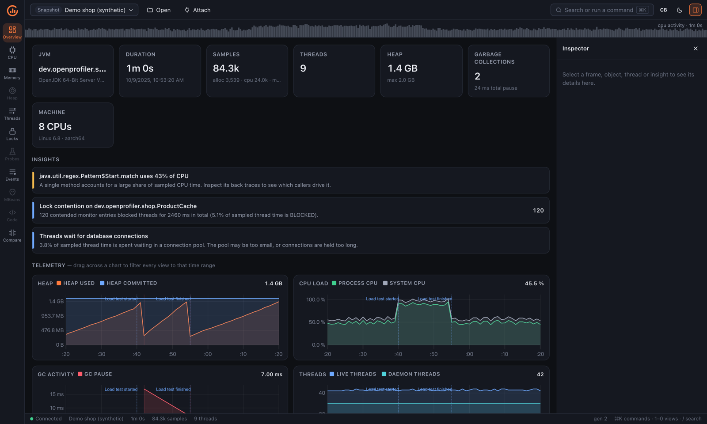
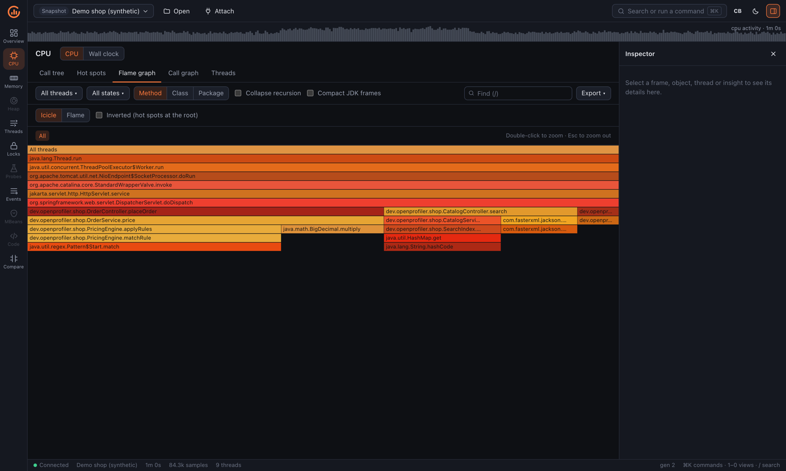

<div align="center">

<picture>
  <source media="(prefers-color-scheme: dark)" srcset="docs/assets/logo-dark.svg">
  
</picture>

**An open-source profiler for the JVM.**<br>
CPU, memory, heap dumps, threads, locks and request probes — live or from a file.

[](https://github.com/matusso/openprofiler/actions/workflows/ci.yml)
[](https://github.com/matusso/openprofiler/actions/workflows/release.yml)
[](https://sonarcloud.io/summary/new_code?id=matusso_openprofiler)
[](https://sonarcloud.io/summary/new_code?id=matusso_openprofiler)
[](https://github.com/matusso/openprofiler/releases)
[](LICENSE)

[Install](#install) · [Quick start](#quick-start) · [Usage guide](docs/USAGE.md) · [Architecture](docs/ARCHITECTURE.md) · [Building](docs/BUILDING.md)

<br>



</div>

## About

OpenProfiler finds where your Java application spends CPU time, what it allocates, what holds on
to memory, and where threads wait on each other. It works on running JVMs (local, remote, in
Docker or Kubernetes) and on saved files such as JFR recordings and HPROF heap dumps.

It is written in Rust — a native JVMTI agent, fast analysis engines, a daemon and a CLI — with a
React UI served in the browser or as a Tauri desktop app.

## Features

- **CPU** — call tree, hot spots, flame graph and call graph, with async sampling on Linux.
- **Memory and heap dumps** — allocation hot spots, GC telemetry, and out-of-core HPROF analysis
  with dominator tree and retained sizes identical to Eclipse MAT. A 10 GB dump opens in ~25 s.
- **Threads and locks** — thread history, dumps, monitor and `java.util.concurrent` contention,
  virtual threads.
- **Probes** — SQL, HTTP, JPA, Kafka, gRPC, MongoDB, JMS, AI/LLM clients and more, with call trees
  split by request across thread pools and reactive schedulers. Custom probes with one annotation.
- **Exact call counts** — bytecode instrumentation of the packages you choose.
- **Remote and containers** — attach over ssh, `docker exec` and `kubectl exec`, including
  distroless pods. No port is exposed on the target.
- **Snapshots and CI** — save, compare and export sessions; fail a build on regressions with
  `--fail-if "cpu.total > +10%"`.
- **Automation** — a CLI and an MCP server so AI agents can profile and read results.
- **Decompiler** — browse `.apk`, `.dex`, `.jar` or `.class` files as Java source.
- **IDE integration** — IntelliJ IDEA and VS Code plugins with CPU heat in the editor.
- **Secure by default** — the agent link uses TLS 1.3 with a pinned fingerprint and a random token.

<details>
<summary>Flame graph</summary>
<br>

</details>

## Install

```sh
brew install matusso/tap/openprofiler                       # macOS and Linux (amd64, arm64)
docker run --rm -p 7878:7878 ghcr.io/matusso/openprofiler   # daemon + web UI
```

Archives for macOS, Linux and Windows (amd64, arm64) are on the
[releases page](https://github.com/matusso/openprofiler/releases). Each holds the `openprofiler`
CLI, the native agent, the web UI and the remote bundle; keep them together. On Windows the agent
uses the sync sampler, and the windows-arm64 archive has no agent.

## Quick start

```sh
openprofiler daemon --web --demo                      # explore the UI with a demo session
openprofiler list                                     # local JVMs
openprofiler attach <pid> --duration 10s              # live hot spots in the terminal
openprofiler record --pid <pid> --duration 60s -o app.opsnap
openprofiler daemon --web heap.hprof                  # open a file in the UI
openprofiler attach --kube prod/shop-api-0            # a JVM in Kubernetes
```

Or start a JVM with the agent:

```sh
java -agentpath:/path/to/libopenprofiler_agent.so=port=0 -jar app.jar
```

See the [usage guide](docs/USAGE.md) for remote attach, probes, the decompiler, CI gates, MCP and
IDE plugins.

## Documentation

| Document | Contents |
|---|---|
| [Usage guide](docs/USAGE.md) | CLI and UI walkthroughs for every feature |
| [Architecture](docs/ARCHITECTURE.md) | How it works and the repository layout |
| [Building from source](docs/BUILDING.md) | Requirements, build, tests and releases |
| [Design](docs/DESIGN.md) | Full design notes and roadmap |
| [Specifications](docs/spec) | Agent link, Query API and snapshot format |

## Project status

OpenProfiler is in active development. The offline analyzer, live agent, probes, bytecode
instrumentation and most of remote attach work today. Probes are tested against 49 library and
version combinations, and on Spring Petclinic the agent with probes costs about 1% throughput
(see the [benchmark](docs/DESIGN.md#4-roadmap)). Planned work is tracked in
[GitHub issues](https://github.com/matusso/openprofiler/issues).

## License

Apache-2.0, see [LICENSE](LICENSE). The native agent (`crates/openprofiler-agent`) is MPL-2.0, see
[its LICENSE](crates/openprofiler-agent/LICENSE).
